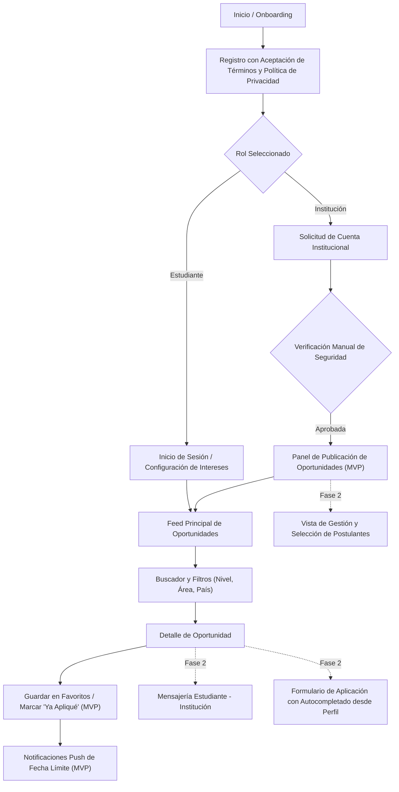

# Documento de Visión y Alcance del Producto (PRD)
**Proyecto:** **Becify** — Plataforma Móvil Centralizada de Becas y Oportunidades Académicas  

| Metadato | Detalle |
| :--- | :--- |
| **Código de Documento** | `DOC-01-PRD` |
| **Nombre del Producto** | **Becify** |
| **Versión** | `1.1.0` |
| **Estado** | Aprobado — Baseline Sprint 0 |
| **Autores** | **Diana Estephan Ferreras Feliz** (Ingeniería de Software — Scrum Master & Frontend/UI) **Deurys Mercedes Batista** (Ciberseguridad — Seguridad, Base de Datos & Backend) |
| **Product Ownership** | Gobernanza compartida (Decisiones consensuadas y trazadas en el Product Backlog) |

---

## Tabla de Contenidos
1. [Resumen Ejecutivo y Declaración del Problema](#1-resumen-ejecutivo-y-declaración-del-problema)
2. [Objetivos del Producto](#2-objetivos-del-producto)
3. [Identidad del Producto: Selección de Nombre (Becify)](#3-identidad-del-producto-selección-de-nombre-becify)
4. [Perfiles de Usuario y Roles del Sistema](#4-perfiles-de-usuario-y-roles-del-sistema)
5. [Arquitectura de Flujo de Usuario](#5-arquitectura-de-flujo-de-usuario)
6. [Alcance Funcional: MVP vs. Fase 2](#6-alcance-funcional-mvp-vs-fase-2)
7. [Matriz de Riesgos de Producto y Mitigación](#7-matriz-de-riesgos-de-producto-y-mitigación)

---

## 1. Resumen Ejecutivo y Declaración del Problema

### 1.1 Contexto y Problema
El acceso a oportunidades de financiamiento y formación académica (becas, intercambios y programas de apoyo para niveles de secundaria, grado, posgrado, maestría y doctorado) presenta una alta fragmentación informativa. Actualmente, las convocatorias se publican de manera dispersa en portales gubernamentales, sitios web universitarios, redes sociales y boletines aislados.

Esta dispersión genera tres fricciones críticas:
1. **Para el estudiante:** Pérdida de oportunidades por desconocimiento de fechas límite, dificultad para filtrar programas según su perfil académico y falta de un sistema centralizado para dar seguimiento a sus postulaciones.
2. **Para las instituciones oferentes:** Bajo alcance en segmentos estudiantiles calificados y ausencia de un canal estandarizado y verificable para difundir sus programas.
3. **Riesgo de desinformación y fraude:** Proliferación de enlaces no oficiales o convocatorias apócrifas que comprometen los datos personales de los postulantes.

### 1.2 Propuesta de Valor
Desarrollar **Becify**, una **aplicación móvil multiplataforma (iOS y Android)** segura y centralizada que conecta a estudiantes de todos los niveles educativos con instituciones verificadas, permitiendo descubrir, filtrar, guardar y gestionar oportunidades académicas con recordatorios oportunos y controles estrictos de privacidad y autenticidad.

---

## 2. Objetivos del Producto

### 2.1 Objetivo General
Centralizar en **Becify** las oportunidades de estudio ofrecidas por instituciones educativas, fundaciones y organismos nacionales e internacionales para estudiantes de **secundaria, grado, posgrado, maestría y doctorado**, promoviendo y reconociendo el mérito y la trayectoria estudiantil.

### 2.2 Objetivos Específicos
- **Descubrimiento estructurado:** Reducir el tiempo de búsqueda mediante un feed personalizado y filtros multicriterio (nivel académico, área de conocimiento, país/modalidad).
- **Veracidad y confianza:** Garantizar que toda institución que publique en la plataforma pase por un flujo de verificación previo para prevenir estafas.
- **Retención y seguimiento:** Proveer herramientas de organización personal (guardado de becas, registro de estado *"Ya apliqué"* y alertas automáticas de vencimiento).
- **Privacidad desde el diseño (*Privacy by Design*):** Recolectar únicamente los datos personales estrictamente necesarios para la operación del servicio.

---

## 3. Identidad del Producto: Selección de Nombre (Becify)

Tras el proceso de evaluación de identidad en el **Sprint 0**, el equipo ha definido oficialmente **Becify** como el nombre de la aplicación.

### 3.1 Justificación del Nombre Elegido: **Becify**
- **Reconocimiento inmediato:** Conserva la raíz *"Bec-"* (Beca), haciendo explícito desde el primer contacto el propósito académico de la aplicación.
- **Sufijo de acción tecnológica (*"-ify"*):** Evoca transformación, simplificación y dinamismo digital (*"simplificar y activar el acceso a becas"*), alineándose con marcas tecnológicas modernas de alcance global.
- **Equilibrio de tono:** Proyecta una identidad tecnológica, seria y confiable ante universidades y fundaciones, manteniendo a la vez un nombre corto (6 letras, 3 sílabas), memorable y cercano al público estudiantil.

### 3.2 Registro Histórico de Alternativas Evaluadas

| Candidato | Enfoque / Concepto | Resolución |
| :--- | :--- | :--- |
| **Becify** | Raíz *Beca* + sufijo tecnológico *-ify* (acción, transformación y acceso digital). | **Seleccionado (Nombre Oficial)** |
| **BecaHub** | Punto central de conexión de becas; claro y descriptivo. | Descartado en ronda final |
| **Meritum** | Enfoque en el mérito y excelencia académica; tono institucional. | Descartado en ronda final |
| **Beca+** | Corto, directo y orientado a valor agregado. | Descartado (menor distintividad en búsqueda) |
| **Merinex** | Fusión de *Mérito* + *Nexo*; identidad tecnológica moderna. | Descartado (menor asociación directa con becas) |
| **Becanova** | Connotación de innovación y nuevas oportunidades en becas. | Descartado en ronda final |
| **Cenit** | Punto más alto de desarrollo académico. | Descartado (falta de asociación directa con becas) |

---

## 4. Perfiles de Usuario y Roles del Sistema

El sistema implementa control de acceso basado en roles (**RBAC**) con separación estricta de permisos:

| Rol | Identificador | Descripción | Responsabilidades y Capacidades Clave |
| :--- | :--- | :--- | :--- |
| **Estudiante** | `student` | Usuario final en búsqueda de oportunidades académicas (secundaria a doctorado). | - Crear cuenta y configurar perfil de intereses. - Explorar el feed, buscar y filtrar convocatorias. - Guardar becas en favoritos y marcar estado *"Ya apliqué"*. - Recibir notificaciones push de vencimientos y novedades. - *(Fase 2)* Comunicarse con instituciones y postular vía formularios integrados. |
| **Institución** | `institution` | Universidad, ministerio, ONG o fundación que ofrece programas de becas. | - Solicitar registro institucional y aportar datos de validación. - Crear, editar y gestionar el ciclo de vida de sus oportunidades (título, nivel, área, país, requisitos, fecha límite, enlace oficial). - *(Fase 2)* Gestionar candidatos interesados y mensajería directa. |
| **Administrador** | `admin` | Equipo interno de gobernanza y seguridad de la plataforma. | - Revisar y aprobar manualmente cuentas institucionales antes de habilitar sus permisos de publicación. - Auditar convocatorias reportadas o sospechosas. |

---

## 5. Arquitectura de Flujo de Usuario

El siguiente diagrama modela la experiencia integral del usuario contemplando tanto el alcance del **MVP** como las capacidades proyectadas para la **Fase 2**:

---

## 6. Alcance Funcional: MVP vs. Fase 2

Para garantizar entregas incrementales de alto valor y calidad técnica, el desarrollo se divide en un **Producto Mínimo Viable (MVP)** enfocado en descubrimiento seguro y seguimiento, y una **Fase 2** orientada a postulación nativa e interacción bilateral.

### 6.1 Requerimientos Funcionales del MVP (Sprints 1 al 4)

| ID | Módulo | Requerimiento Funcional | Prioridad (MoSCoW) | Sprint Objetivo |
| :--- | :--- | :--- | :---: | :---: |
| **RF-01** | Autenticación y Legal | Registro e inicio de sesión diferenciando los roles `student` e `institution`, con aceptación explícita de Términos de Uso y Política de Privacidad, y verificación de correo electrónico. | **Must Have** | Sprint 1 |
| **RF-02** | Verificación Institucional | Estado de espera (`pending_verification`) para cuentas de tipo `institution` hasta su aprobación manual, impidiendo publicaciones no autorizadas. | **Must Have** | Sprint 1 - 2 |
| **RF-03** | Gestión de Convocatorias | CRUD de oportunidades para instituciones verificadas, incluyendo: título, descripción, nivel educativo, área de estudio, país, requisitos, fecha límite y enlace oficial externo. | **Must Have** | Sprint 2 |
| **RF-04** | Feed, Búsqueda y Filtros | Visualización paginada de oportunidades activas con búsqueda por texto y filtros combinables por **nivel académico** (secundaria, grado, posgrado, maestría, doctorado), **área** y **país**. | **Must Have** | Sprint 3 |
| **RF-05** | Seguimiento Personal | Funcionalidad para que el estudiante guarde oportunidades en su lista de seguimiento y marque el estado *"Ya apliqué"*. | **Must Have** | Sprint 4 |
| **RF-06** | Notificaciones Básicas | Envío de notificaciones push recordatorias antes del cierre de una convocatoria guardada (7 días y 1 día antes de la fecha límite). | **Should Have** | Sprint 4 |

### 6.2 Alcance de la Fase 2 (Evolución Post-MVP)
1. **Mensajería Estudiante-Institución:** Canal de consultas directas dentro de la aplicación con alertas de mensajes no leídos.
2. **Formularios de Aplicación Nativos:** Postulación directa sin salir de la app para instituciones que opten por gestionar el proceso internamente.
3. **Perfil Académico Enriquecido y Autocompletado:** Registro de actividades extracurriculares, méritos e historial académico para autocompletar formularios de solicitud con un toque.
4. **Panel de Selección para Instituciones:** Vista estructurada para filtrar, evaluar y actualizar el estado de las solicitudes de los candidatos.
5. **Motor de Recomendaciones:** Sugerencias proactivas en el feed basadas en la afinidad entre el perfil del estudiante y los requisitos de las becas.

### 6.3 Fuera de Alcance en el MVP (*Out of Scope*)
- Procesamiento de pagos o cobro de comisiones dentro de la aplicación.
- Verificación automatizada de documentos académicos oficiales (títulos, récords de notas) mediante integraciones gubernamentales.
- Chat grupal o foros abiertos entre estudiantes.

---

## 7. Matriz de Riesgos de Producto y Mitigación

| ID | Riesgo Identificado | Categoría | Probabilidad | Impacto | Estrategia de Mitigación |
| :--- | :--- | :---: | :---: | :---: | :--- |
| **R-01** | **Arranque en frío (*Cold Start*):** Que los primeros estudiantes ingresen a la app y encuentren pocas convocatorias disponibles. | Producto / Adopción | Alta | Alto | Precargar inicialmente en la base de datos un lote curado (*seed data*) de **30 a 50 oportunidades reales y vigentes** de fuentes oficiales verificadas antes del lanzamiento. |
| **R-02** | **Suplantación institucional o estafas (*Phishing*):** Creación de perfiles falsos que simulen ser universidades o fundaciones para captar datos de estudiantes. | Seguridad / Reputación | Media | Crítico | Imponer verificación manual obligatoria de cuentas institucionales antes de otorgar permisos de escritura en la tabla pública de oportunidades, junto con validación de dominios de correo institucionales. |
| **R-03** | **Exposición de datos personales de estudiantes:** Recolección excesiva de información sensible en etapas tempranas. | Privacidad / Legal | Baja | Crítico | Aplicar el principio de **minimización de datos** (solicitar solo lo indispensable para el rol en el MVP), políticas estrictas de acceso por fila (RLS) y cumplimiento de buenas prácticas OWASP MASVS. |
