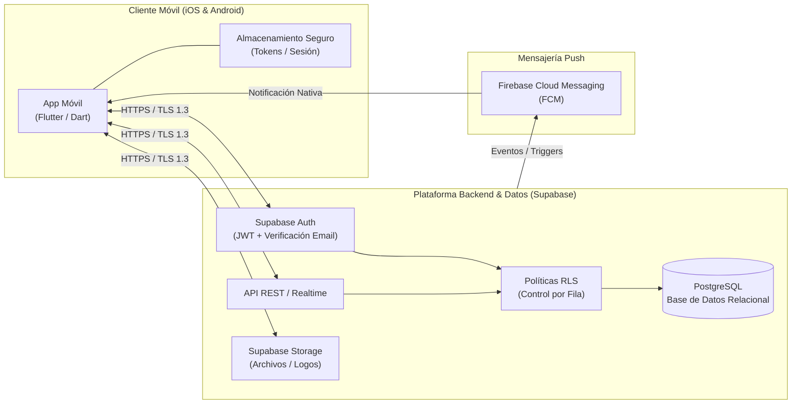

# Arquitectura Técnica, Stack y Estrategia de Seguridad
**Proyecto:** **Becify** — Plataforma Móvil Centralizada de Becas y Oportunidades Académicas  

| Metadato | Detalle |
| :--- | :--- |
| **Código de Documento** | `DOC-02-ARCH-SEC` |
| **Nombre del Producto** | **Becify** |
| **Versión** | `1.1.0` |
| **Estado** | Aprobado — Baseline Sprint 0 |
| **Autores** | **Deurys Mercedes Batista** (Líder de Ciberseguridad, Base de Datos Relacional & Backend) **Diana Estephan Ferreras Feliz** (Líder de Frontend Móvil Flutter/UI & Scrum Master) |

---

## Tabla de Contenidos
1. [Visión General de la Arquitectura](#1-visión-general-de-la-arquitectura)
2. [Premisas y Restricciones de Ingeniería](#2-premisas-y-restricciones-de-ingeniería)
3. [Stack Tecnológico Seleccionado](#3-stack-tecnológico-seleccionado)
4. [Decisiones Arquitectónicas (ADRs)](#4-decisiones-arquitectónicas-adrs)
5. [Arquitectura del Sistema de Notificaciones](#5-arquitectura-del-sistema-de-notificaciones)
6. [Arquitectura de Seguridad y Privacidad (Security by Design)](#6-arquitectura-de-seguridad-y-privacidad-security-by-design)
7. [Requerimientos No Funcionales (RNF)](#7-requerimientos-no-funcionales-rnf)

---

## 1. Visión General de la Arquitectura

La plataforma sigue una arquitectura **Cliente-Servidor orientada a servicios gestionados (BaaS / Serverless)** sobre una base de datos relacional con seguridad a nivel de motor (**PostgreSQL + Row Level Security**). Este diseño reduce la superficie de ataque del backend tradicional, acelera la entrega de valor en un equipo de dos ingenieros y garantiza escalabilidad e integridad referencial.

---

## 2. Premisas y Restricciones de Ingeniería

1. **Sostenibilidad financiera (*Zero-Cost Development Tier*):** Durante las fases de desarrollo, validación y lanzamiento del MVP se priorizan plataformas con capas gratuitas robustas (*free-tier*), difiriendo costos de infraestructura hasta alcanzar métricas de tracción que lo justifiquen.
2. **Alineación con competencias técnicas del equipo:** Aprovechamiento directo de la base técnica del equipo en desarrollo móvil con **Flutter/Dart** (Android Studio) y modelado de **bases de datos relacionales SQL** (experiencia previa en MySQL y SQL Server trasladada a PostgreSQL).
3. **Excelencia de ingeniería y portafolio:** El proyecto se ejecuta recorriendo formalmente todas las etapas del Ciclo de Vida de Desarrollo de Software Seguro (**S-SDLC**), desde el modelado de amenazas hasta pruebas de seguridad previas al lanzamiento.

---

## 3. Stack Tecnológico Seleccionado

| Capa / Dominio | Tecnología / Herramienta | Rol dentro del Sistema | Responsable Principal |
| :--- | :--- | :--- | :--- |
| **Aplicación Móvil** | **Flutter & Dart** | Desarrollo multiplataforma nativo para **Android e iOS** a partir de una única base de código (*Single Codebase*). | Diana Estephan Ferreras Feliz |
| **Base de Datos** | **PostgreSQL (en Supabase)** | Motor relacional para almacenar usuarios, perfiles institucionales, convocatorias, filtros y estados de seguimiento con integridad referencial. | Deurys Mercedes Batista |
| **Backend & Autenticación** | **Supabase (Auth, API, Storage, Realtime)** | Gestión de identidades, emisión de JWT, almacenamiento de activos, suscripciones en tiempo real y políticas de seguridad **RLS**. | Deurys Mercedes Batista |
| **Notificaciones Push** | **Firebase Cloud Messaging (FCM)** | Entrega gratuita y confiable de notificaciones push nativas en dispositivos Android e iOS. | Ambos |
| **Diseño UI/UX** | **Figma** | Prototipado de alta fidelidad, sistema de diseño (*Design System*) y validación de flujos de usuario. | Diana Estephan Ferreras Feliz |
| **Control de Versiones y Gestión** | **GitHub (Repos, Projects, Issues, Actions)** | Alojamiento del monorepo, gestión ágil del backlog, revisión de código por Pull Request y escaneo automatizado de seguridad. | Ambos |
| **Asistencia de Ingeniería IA** | **Antigravity** | Copiloto de ingeniería para revisión de arquitectura, documentación técnica, generación asistida y depuración en paralelo. | Ambos |

---

## 4. Decisiones Arquitectónicas (ADRs)

### ADR-01: Elección de Flutter Nativo frente a Progressive Web App (PWA)
- **Contexto:** Se evaluó construir una PWA para evitar la compilación móvil nativa.
- **Decisión:** Construir una aplicación móvil compilada nativamente con **Flutter**.
- **Justificación Técnica:**
  1. En **iOS (iPhone)**, las notificaciones Web Push de una PWA solo funcionan si el usuario instala manualmente la página en su pantalla de inicio, lo cual degrada severamente la tasa de recepción de alertas de vencimiento de becas.
  2. Flutter compila a código nativo ARM, ofreciendo notificaciones push de primer nivel en Android e iOS, mejor rendimiento en listas y filtros, y acceso seguro al llavero del sistema operativo para resguardar tokens de sesión.

### ADR-02: Elección de Supabase (PostgreSQL) frente a Firebase Firestore (NoSQL)
- **Contexto:** Se evaluó utilizar la suite completa de Firebase (incluyendo Cloud Firestore como base de datos).
- **Decisión:** Adoptar **Supabase (PostgreSQL)** para datos, autenticación y backend, manteniendo de Firebase únicamente **FCM** para notificaciones push.
- **Justificación Técnica:**
  1. El dominio del problema es intrínsecamente **relacional**: oportunidades vinculadas a instituciones verificadas, niveles educativos, áreas de estudio, países, usuarios y estados de postulación.
  2. Las búsquedas combinadas y filtros multicriterio en el feed se resuelven de forma óptima, consistente y sin duplicación de datos mediante consultas SQL indexadas en PostgreSQL, mientras que en bases orientadas a documentos (NoSQL) imponen limitaciones en consultas compuestas y costos por lectura.
  3. **Row Level Security (RLS)** de PostgreSQL permite definir reglas criptográficas y declarativas de control de acceso directamente sobre las tablas.

---

## 5. Arquitectura del Sistema de Notificaciones

El sistema de notificaciones está diseñado bajo un enfoque de **consentimiento granular (*Opt-in / Opt-out*)**, permitiendo que cada usuario configure en su perfil qué tipos de alertas desea recibir.

| Código | Evento Disparador | Condición de Disparo | Fase | Configurable por Usuario |
| :--- | :--- | :--- | :---: | :---: |
| **NOTIF-01** | **Recordatorio de fecha límite (Preventivo)** | 7 días calendario antes del cierre (`deadline`) de una oportunidad guardada por el estudiante. | **MVP** | Sí |
| **NOTIF-02** | **Recordatorio de fecha límite (Urgente)** | 24 horas (1 día) antes del cierre de una oportunidad guardada que aún no esté marcada como *"Ya apliqué"*. | **MVP** | Sí |
| **NOTIF-03** | **Nuevo mensaje sin leer** | Recepción de un mensaje en el canal estudiante-institución. | **Fase 2** | Sí |
| **NOTIF-04** | **Cambio de estado de solicitud** | Actualización del estado de la postulación por parte de la institución (*En revisión*, *Preseleccionado*, *Finalizado*). | **Fase 2** | Sí |
| **NOTIF-05** | **Selección del estudiante** | Confirmación oficial de otorgamiento o preselección en la beca aplicada. | **Fase 2** | Sí |

---

## 6. Arquitectura de Seguridad y Privacidad (Security by Design)

La estrategia de ciberseguridad está liderada por **Deurys Mercedes Batista** y se integra transversalmente desde el **Sprint 0** hasta el despliegue en producción.

### 6.1 Pilares de Seguridad del Sistema

1. **Modelado de Amenazas Temprano (*Threat Modeling*):**
   - Ejecución de un análisis de amenazas en el **Sprint 0** (ubicado en `/docs/seguridad`) antes de escribir código de producción, identificando vectores de abuso en registro, publicación de enlaces externos y consumo de API.
2. **Autenticación Robusta y Gestión de Sesiones:**
   - Hashing seguro de contraseñas gestionado por Supabase Auth (bcrypt/Argon2).
   - Verificación obligatoria de correo electrónico antes de activar la cuenta.
   - Emisión de tokens **JWT** de corta duración y almacenamiento seguro de credenciales en el dispositivo móvil (evitando `SharedPreferences` en texto plano).
3. **Verificación y Gobernanza de Cuentas Institucionales (Anti-Fraude):**
   - Ninguna cuenta registrada con el rol `institution` obtiene permisos de publicación de forma automática.
   - Toda institución nace con estado `is_verified = false` y requiere **aprobación manual** tras validar su legitimidad, mitigando ataques de *phishing* o convocatorias falsas.
4. **Control de Acceso a Nivel de Fila (*Row Level Security - RLS*):**
   - Todas las tablas del esquema `public` en PostgreSQL tendrán **RLS habilitado por defecto**.
   - **Regla de aislamiento:** Un estudiante únicamente puede leer y modificar sus propios registros de becas guardadas, perfil y postulaciones (`auth.uid() = user_id`).
   - **Regla de publicación:** Solo usuarios con rol `institution` y atributo `is_verified = true` pueden insertar o actualizar oportunidades asociadas a su propia institución.
5. **Minimización de Datos y Gestión de Secretos:**
   - Recolección estrictamente mínima de Datos Personales Identificables (**PII**) de los estudiantes.
   - Prohibición absoluta de almacenar credenciales, llaves privadas o `.env` en el repositorio Git. Uso de variables de entorno inyectadas en compilación y activación de **GitHub Secret Scanning** y **Dependabot**.
6. **Auditoría Continua y Cumplimiento OWASP:**
   - Revisión de criterios de seguridad en cada Pull Request al cierre de cada Sprint.
   - Evaluación de vulnerabilidades previo al lanzamiento guiada por los estándares **OWASP Mobile Top 10** y **OWASP MASVS** (*Mobile Application Security Verification Standard*).

---

## 7. Requerimientos No Funcionales (RNF)

| ID | Categoría | Especificación del Requerimiento | Métrica / Criterio de Aceptación |
| :--- | :--- | :--- | :--- |
| **RNF-01** | **Seguridad en Tránsito** | Toda comunicación entre la app Flutter, Supabase y FCM debe realizarse sobre canales cifrados. | 100% de tráfico bajo **HTTPS / TLS 1.2+**. |
| **RNF-02** | **Aislamiento de Datos** | Ningún usuario autenticado o anónimo debe poder acceder a datos privados de otro usuario mediante manipulación de parámetros en la API. | 100% de las tablas con políticas **RLS** activas y probadas con casos negativos. |
| **RNF-03** | **Rendimiento de Búsqueda** | Las consultas de filtrado del feed por nivel, área y país deben responder con fluidez. | Tiempo de respuesta de consulta menor a **500 ms** para lotes paginados. |
| **RNF-04** | **Portabilidad Multiplataforma** | El código fuente en Flutter debe compilar y mantener paridad visual y funcional en ambos sistemas operativos móviles. | Compatibilidad verificada en **Android** e **iOS**. |
| **RNF-05** | **Mantenibilidad y Trazabilidad** | Todo cambio en esquema de base de datos o reglas de seguridad debe estar versionado en el repositorio. | Scripts SQL y migraciones documentados bajo `/database`. |
