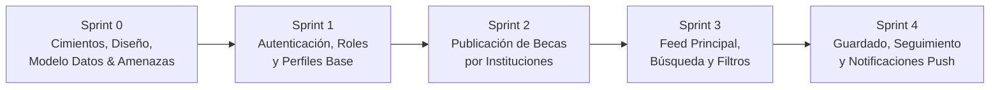

# Gobernanza del Equipo, Marco Ágil (Scrum) y Flujo de Ingeniería en GitHub
**Proyecto:** **Becify** — Plataforma Móvil Centralizada de Becas y Oportunidades Académicas  

| Metadato | Detalle |
| :--- | :--- |
| **Código de Documento** | `DOC-03-GOV-SCRUM` |
| **Nombre del Producto** | **Becify** |
| **Versión** | `1.1.0` |
| **Estado** | Aprobado — Baseline Sprint 0 |
| **Autores** | **Diana Estephan Ferreras Feliz** (Scrum Master & Líder de Frontend Móvil / UI)<br>**Deurys Mercedes Batista** (Líder de Ciberseguridad, Base de Datos & Backend) |

---

## Tabla de Contenidos
1. [Estructura del Equipo y Matriz de Responsabilidades (RACI)](#1-estructura-del-equipo-y-matriz-de-responsabilidades-raci)
2. [Marco Ágil: Scrum Adaptado a Micro-Equipo (2 Personas)](#2-marco-ágil-scrum-adaptado-a-micro-equipo-2-personas)
3. [Hoja de Ruta de Sprints (Roadmap del MVP)](#3-hoja-de-ruta-de-sprints-roadmap-del-mvp)
4. [Estándares de Ingeniería y Flujo de Trabajo en GitHub](#4-estándares-de-ingeniería-y-flujo-de-trabajo-en-github)
5. [Definition of Ready (DoR) y Definition of Done (DoD)](#5-definition-of-ready-dor-y-definition-of-done-dod)

---

## 1. Estructura del Equipo y Matriz de Responsabilidades (RACI)

El proyecto es ejecutado por un equipo multidisciplinario de dos integrantes con especializaciones complementarias en **Ingeniería de Software** y **Ciberseguridad**, garantizando tanto una experiencia de usuario moderna como una arquitectura de datos robusta y segura.

### 1.1 Integrantes y Roles Oficiales

| Integrante | Perfil Académico / Especialidad | Rol en Scrum | Dominios de Responsabilidad Técnica |
| :--- | :--- | :--- | :--- |
| **Diana Estephan Ferreras Feliz** | Estudiante de Ingeniería de Software (INTEC) | **Scrum Master**<br>& Co-Product Owner | - Facilitación del marco Scrum y gestión de impedimentos.<br>- Arquitectura y desarrollo Frontend móvil en **Flutter / Dart**.<br>- Diseño de interfaz y experiencia de usuario (**UI/UX en Figma**).<br>- Integración de pantallas con servicios de backend. |
| **Deurys Mercedes Batista** | Estudiante de Ciberseguridad | **Security & Backend Lead**<br>& Co-Product Owner | - Arquitectura de **Ciberseguridad**, modelado de amenazas y análisis forense.<br>- Diseño e implementación de base de datos relacional (**PostgreSQL**).<br>- Configuración de **Supabase** (Auth, API, Storage y políticas **RLS**).<br>- Pruebas de vulnerabilidades (OWASP/MASVS) y revisión de seguridad por Sprint. |

> **Gobernanza del Product Owner:** Las decisiones de priorización de negocio y alcance del producto se toman de forma colegiada entre ambos integrantes. Toda decisión de producto acordada queda formalmente registrada y trazada como elemento dentro del **Product Backlog** en GitHub Projects.

### 1.2 Matriz RACI por Área de Trabajo
*(**R** = Responsible / Ejecuta, **A** = Accountable / Aprobador final, **C** = Consulted / Consultado, **I** = Informed / Informado)*

| Actividad / Entregable | Diana Estephan Ferreras Feliz | Deurys Mercedes Batista |
| :--- | :---: | :---: |
| **Facilitación Scrum, Planificación y Seguimiento del Tablero** | **R / A** | **C** |
| **Definición de Visión, Alcance y Product Backlog** | **R / A** | **R / A** |
| **Diseño UI/UX y Prototipos en Figma** | **R / A** | **C** |
| **Desarrollo Móvil en Flutter / Dart** | **R / A** | **C** |
| **Modelado de Datos Relacional (PostgreSQL) y Migraciones** | **C** | **R / A** |
| **Configuración de Supabase y Reglas de Acceso (RLS)** | **C** | **R / A** |
| **Modelado de Amenazas, Auditoría OWASP y Pruebas de Seguridad** | **I** | **R / A** |
| **Code Review de Pull Requests (Revisión Cruzada Obligatoria)** | **R** (aprueba PRs de Backend/Sec) | **R** (aprueba PRs de Frontend/UI) |

---

## 2. Marco Ágil: Scrum Adaptado a Micro-Equipo (2 Personas)

Para maximizar la velocidad de entrega sin incurrir en burocracia innecesaria, se implementa un esquema **Micro-Team Scrum** con iteraciones cortas de **1 semana** y trazabilidad documental completa.

### 2.1 Ceremonias del Sprint

| Ceremonia | Frecuencia / Duración | Formato | Objetivo y Entregable |
| :--- | :--- | :--- | :--- |
| **Sprint Planning** | Inicio de cada Sprint<br>*(30 - 45 minutos)* | Sesión sincrónica | Seleccionar las Historias de Usuario del Product Backlog según las horas reales disponibles en la semana y definir el **Sprint Goal**. Se documenta en `/docs/sprint-N`. |
| **Daily Scrum** | Diario<br>*(Asíncrono / Escrito)* | Registro escrito breve | Responder 3 preguntas clave:<br>1. ¿Qué completé ayer?<br>2. ¿Qué haré hoy?<br>3. ¿Tengo algún bloqueo técnico o de disponibilidad? |
| **Sprint Review** | Cierre de cada Sprint<br>*(20 - 30 minutos)* | Demostración práctica | Mostrar el incremento funcional ejecutándose en dispositivo/emulador a una **persona externa al equipo** (estudiante o docente) para recolectar retroalimentación real. |
| **Sprint Retrospective** | Cierre de cada Sprint<br>*(15 minutos)* | Sesión sincrónica | Evaluar qué funcionó bien, qué se debe mejorar en la colaboración/técnica y definir al menos **1 acción concreta de mejora** para el siguiente Sprint. |

### 2.2 Artefactos Oficiales
1. **Product Backlog:** Lista priorizada de Historias de Usuario, tareas técnicas y requerimientos de seguridad alojada en **GitHub Issues & Projects**.
2. **Sprint Backlog:** Subconjunto de historias comprometidas para la semana en curso, vinculadas al **Milestone** del Sprint correspondiente.
3. **Incremento:** Software funcional, integrado continuamente en la rama `develop` durante el Sprint y liberado hacia `main` al cierre del Sprint mediante Pull Request, verificado bajo el *Definition of Done* y etiquetado con versión (`tag`).
4. **Bitácora de Sprint (`/docs/sprint-N`):** Carpeta dedicada por cada Sprint que almacena el acta de planificación, resultados del review y acuerdos de la retrospectiva.

---

## 3. Hoja de Ruta de Sprints (Roadmap del MVP)



| Sprint | Duración | Objetivo del Sprint (*Sprint Goal*) | Entregables Principales |
| :--- | :---: | :--- | :--- |
| **Sprint 0** | 1 Semana | Establecer los cimientos arquitectónicos, visuales y de seguridad del proyecto antes de codificar funcionalidades. | - Documentación base de Visión, Stack y Gobernanza.<br>- Product Backlog con Historias de Usuario iniciales.<br>- Prototipo UI/UX en **Figma**.<br>- Modelo Entidad-Relación de base de datos.<br>- **Modelo de Amenazas** inicial en `/docs/seguridad`. |
| **Sprint 1** | 1 Semana | Implementar el flujo seguro de identidad y diferenciación de roles (`student` e `institution`). | - Pantallas de Registro, Login y aceptación de términos.<br>- Integración con Supabase Auth y verificación de correo.<br>- Estado de verificación pendiente para instituciones.<br>- Políticas RLS iniciales sobre perfiles de usuario. |
| **Sprint 2** | 1 Semana | Habilitar a las instituciones verificadas para publicar y administrar convocatorias de becas. | - Tabla y políticas RLS de oportunidades.<br>- Formulario móvil de creación/edición de becas (título, nivel, área, país, requisitos, fecha límite, enlace oficial).<br>- Validación de entradas y sanitización de URLs. |
| **Sprint 3** | 1 Semana | Permitir a los estudiantes descubrir oportunidades mediante un feed dinámico con búsqueda y filtros. | - Pantalla de Feed principal paginado.<br>- Buscador por palabras clave.<br>- Filtros combinados por nivel educativo, área y país.<br>- Vista detallada de cada oportunidad y carga de *seed data*. |
| **Sprint 4** | 1 Semana | Completar la retención del estudiante con seguimiento personal y alertas de vencimiento. | - Funcionalidad de guardar becas en favoritos.<br>- Marcado y seguimiento de estado *"Ya apliqué"*.<br>- Configuración de **Firebase Cloud Messaging (FCM)**.<br>- Notificaciones recordatorias de fecha límite y cierre del MVP. |

---

## 4. Estándares de Ingeniería y Flujo de Trabajo en GitHub

### 4.1 Estructura Oficial del Monorepo

```text
beca-app/
├── .github/                # Plantillas de Pull Request, Issues y flujos CI/CD
├── app/                    # Código fuente de la aplicación móvil en Flutter / Dart
├── database/               # Esquemas SQL, migraciones de PostgreSQL, políticas RLS y seed data
├── docs/                   # Documentación de ingeniería y gestión del proyecto
│   ├── 01-vision-y-alcance.md
│   ├── 02-stack-y-seguridad.md
│   ├── 03-equipo-scrum-y-github.md
│   ├── seguridad/          # Modelo de amenazas, checklists OWASP MASVS y auditorías
│   └── sprint-0/           # Artefactos de planificación, diseño, backlog y bitácoras (sprint-0..N)
└── README.md               # Portada ejecutiva e índice maestro del repositorio
```

### 4.2 Estrategia de Ramas y Protección (*GitFlow Simplificado*)
- **Rama `develop` (Integración del Sprint):** Es la rama base de trabajo diario. Todas las ramas por tarea nacen de `develop` y deben fusionarse **primero hacia `develop`** mediante Pull Request revisado.
- **Rama `main` (Estable / Release por Sprint):** Representa exclusivamente incrementos cerrados y verificados. Queda prohibido hacer `push` directo o fusionar ramas de tareas directamente en `main`. **Únicamente al final de cada Sprint** se abre un Pull Request desde `develop` hacia `main` para liberar el incremento del Sprint.
- **Revisión cruzada obligatoria:** Todo cambio entra exclusivamente mediante un **Pull Request (PR)** revisado y aprobado por el otro miembro del equipo (Diana aprueba los PRs de Deurys; Deurys aprueba los PRs de Diana).
- **Nomenclatura estándar de ramas por tarea (hacia `develop`):**
  - `feature/<descripcion-corta>` → Nuevas pantallas o funcionalidades en Flutter (ej. `feature/login-screen`).
  - `db/<descripcion-corta>` → Tablas, índices, funciones SQL o datos semilla (ej. `db/opportunities-schema`).
  - `security/<descripcion-corta>` → Políticas RLS, endurecimiento o mitigaciones (ej. `security/rls-institutions`).
  - `docs/<descripcion-corta>` → Creación o actualización de documentación (ej. `docs/sprint-0-backlog`).
  - `fix/<descripcion-corta>` → Corrección de defectos detectados (ej. `fix/filter-query-null`).

### 4.3 Convención de Commits y Versionado
Se adopta el estándar **Conventional Commits** para mantener un historial Git limpio y auditable:
- `feat:` nueva característica para el usuario (`feat: pantalla de login con validación de rol`).
- `fix:` corrección de un bug (`fix: validación de formato de correo en registro`).
- `db:` cambios en esquema SQL o migraciones (`db: crear tabla opportunities e índices de búsqueda`).
- `sec:` controles de seguridad o políticas RLS (`sec: restringir insert en opportunities a instituciones verificadas`).
- `docs:` cambios exclusivos en documentación (`docs: documentar retrospectiva del sprint 1`).

Al finalizar cada Sprint y fusionar el PR de `develop` hacia `main`, se genera un **Git Tag** sobre `main` con versionado semántico (ej. `v0.1.0-sprint1`, `v0.2.0-sprint2`) marcando el incremento entregado.

### 4.4 Gestión en GitHub Projects, Issues y Seguridad del Repositorio
- **Tablero Kanban (GitHub Projects):** Estructurado en 5 columnas:
  1. `Backlog` (Pendiente general priorizado)
  2. `Sprint` (Comprometido para la semana actual)
  3. `En progreso` (En desarrollo activo)
  4. `En revisión` (Pull Request abierto hacia `develop` esperando Code Review y validación de seguridad)
  5. `Hecho` (Cumple el *Definition of Done* y fue fusionado a `develop`, listo para el PR de cierre de Sprint hacia `main`)
- **Trazabilidad:** Cada **GitHub Issue** corresponde a una Historia de Usuario o tarea técnica, y cada **Milestone** corresponde a un Sprint (`Sprint 0`, `Sprint 1`, etc.).
- **Etiquetas Oficiales (*Labels*):** `frontend`, `database`, `security`, `docs`, `bug`.
- **Seguridad Automatizada en GitHub:** Activación obligatoria de **Dependabot** (alertas de dependencias vulnerables en Flutter/terceros) y **Secret Scanning** (bloqueo de llaves o tokens expuestos accidentalmente).

---

## 5. Definition of Ready (DoR) y Definition of Done (DoD)

### 5.1 Definition of Ready (DoR) — Antes de iniciar una Historia
Una Historia de Usuario solo puede pasar al *Sprint Backlog* si cumple con:
- [ ] Está redactada con el formato estándar (*Como [rol], quiero [acción], para [beneficio]*).
- [ ] Cuenta con **Criterios de Aceptación** claros y verificables.
- [ ] Si incluye interfaz gráfica, tiene su diseño o boceto de referencia en **Figma**.
- [ ] Se han identificado sus implicaciones en base de datos y reglas de seguridad (**RLS**).

### 5.2 Definition of Done (DoD) — Para dar una Historia por Completada
Ninguna tarea o Historia de Usuario se mueve a la columna **Hecho** a menos que cumpla **todos** los siguientes criterios:
- [ ] **Código integrado vía Pull Request:** El cambio fue subido en una rama dedicada y aprobado en Code Review por el otro integrante del equipo.
- [ ] **Verificación en dispositivo/emulador:** La funcionalidad fue ejecutada y probada sin errores críticos de compilación ni de interfaz en Android Studio / dispositivo físico.
- [ ] **Cero secretos en el repositorio:** No existen credenciales, URLs sensibles ni claves de API escritas en duro (*hardcoded*) en el código fuente.
- [ ] **Criterios de seguridad validados:** Si la tarea toca datos o backend, cuenta con sus políticas **Row Level Security (RLS)** activas, validación de entradas y visto bueno del líder de seguridad (**Deurys Mercedes Batista**).
- [ ] **Documentación al día:** Los cambios en esquemas SQL (`/database`), decisiones técnicas o actas del sprint (`/docs/sprint-N`) han sido actualizados en el mismo Pull Request.
